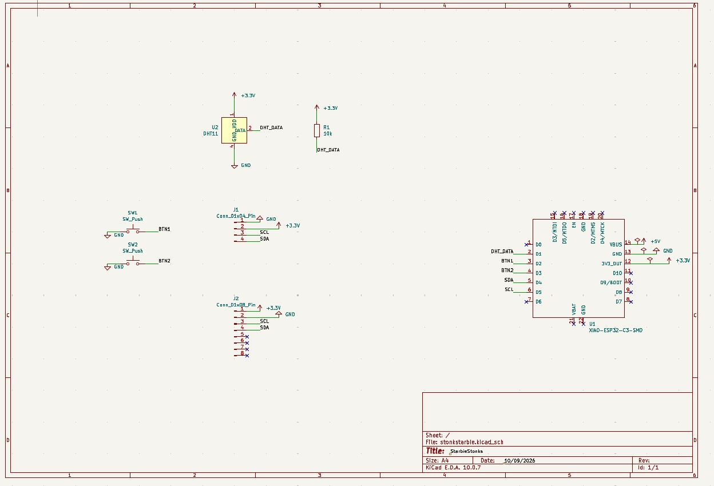

# Starbie Stocks

A tiny motion-controlled desk pet that also watches the stock market. Built for
[Hack Club Half-Life](https://halflife.hackclub.com/) (Week 1 starter project:
Starbie).

Starbie is a XIAO ESP32-C3 board with a 0.96" OLED, an MPU6050 motion sensor, a
DHT11 temperature/humidity sensor and two buttons. The pet wanders around the
screen and reacts when you tilt or shake the board. My twist: a **STOCKS screen**
that shows live prices, the day's change and a sparkline for a watchlist of
tickers, fetched over WiFi.

<!-- Add your renders here once you have them:



-->

## Features

- Wandering 32x32 pixel pet with a tilt-controlled four-item radial menu
  (NAP, PLAY, FEED, PET) and a shake reaction
- Hidden stats screen (joy, energy, fullness, temperature, humidity)
- **Stock screen:** price, percent and dollar change with an up/down arrow, and a
  sparkline of today's price with a dotted yesterday's-close line
- Auto-rotates through your tickers, or step through them with Button 1
- WiFi downloads run in a background task, so the pet stays smooth

## Controls

| Input | STOCKS screen | PET / STATS screen |
| --- | --- | --- |
| Button 1 | Next ticker | Open radial menu / confirm choice |
| Button 2 | Go to PET screen | PET -> STATS -> STOCKS |
| Tilt | (none) | Move the menu ball |
| Shake | (none) | Cheers the pet up |

## Hardware

| Part | Connection |
| --- | --- |
| XIAO ESP32-C3 | Main board, USB powered |
| 0.96" SSD1306 OLED (I2C, 0x3C) | SDA = D4 (GPIO6), SCL = D5 (GPIO7) |
| MPU6050 (I2C, 0x68) | SDA = D4, SCL = D5 |
| DHT11 | Data = D1 (GPIO3) |
| Button 1 | D2 (GPIO4) to GND, internal pull-up |
| Button 2 | D3 (GPIO5) to GND, internal pull-up |

See [BOM.csv](BOM.csv) for the full parts list and prices.

## Firmware setup

1. In Arduino IDE, open **File > Preferences** and add this to *Additional
   Boards Manager URLs*:
   `https://espressif.github.io/arduino-esp32/package_esp32_index.json`
2. Install **esp32 by Espressif Systems** in Boards Manager, then choose
   **XIAO_ESP32C3** and your port.
3. Install these libraries: Adafruit GFX Library, Adafruit SSD1306, Adafruit
   MPU6050, DHT sensor library, and **ArduinoJson** (7.x).
4. Open `Firmware/Starbie/Starbie.ino` and set your `WIFI_SSID`,
   `WIFI_PASSWORD` (2.4 GHz only) and `TICKERS`.
5. Upload.

Never commit your real WiFi password. Leave the placeholders in the repo.

Prices come from Yahoo Finance's public, unofficial chart endpoint with no API
key. It can change or rate-limit at any time, and quotes may be delayed. This is
a toy display, not financial advice.

## Repository layout

```
Firmware/Starbie/Starbie.ino   Arduino sketch (single file)
PCB/                           KiCad project and Gerber export
Renders/                       Schematic, PCB and 3D screenshots
BOM.csv                        Bill of materials
```

## Credits

Based on the Starbie starter project by
[SharKingStudios](https://github.com/SharKingStudios/Starbie) (MIT licensed).
Stock screen, WiFi and data fetching added by me.

## License

MIT. See [LICENSE](LICENSE).
