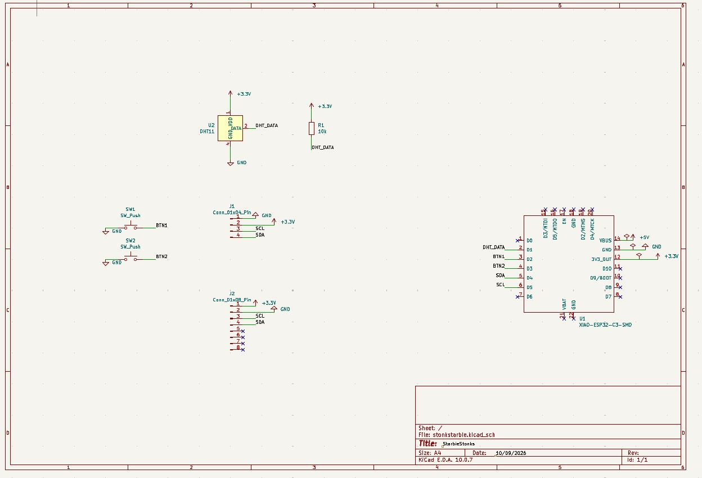
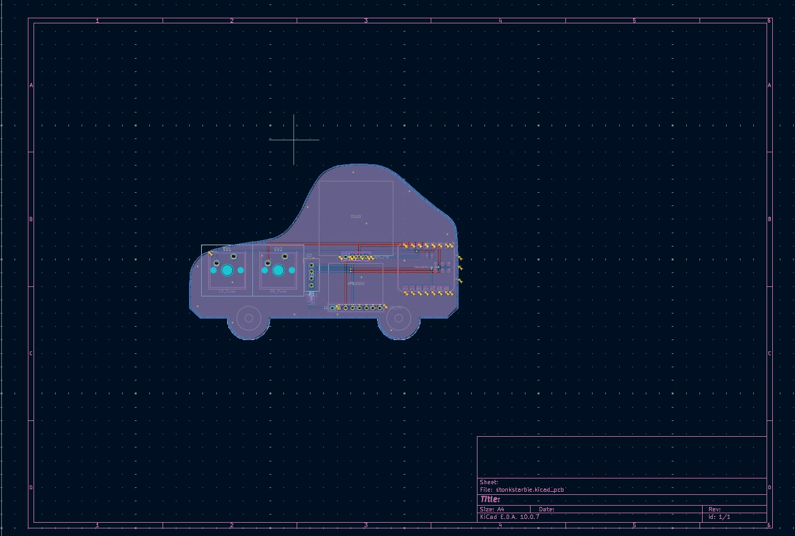
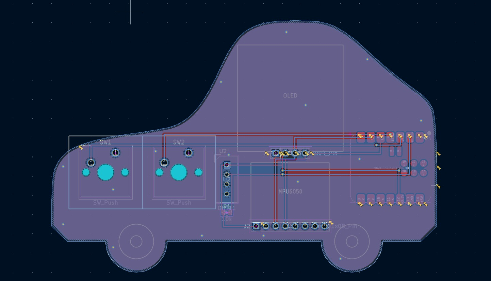
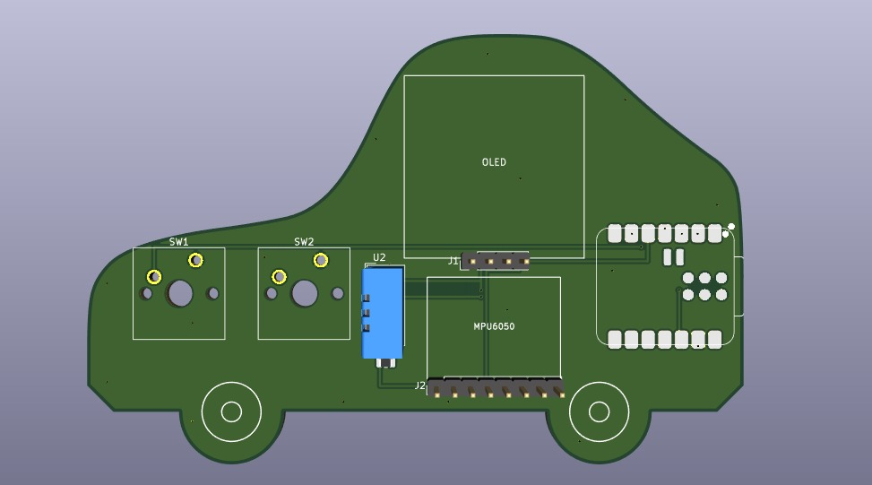
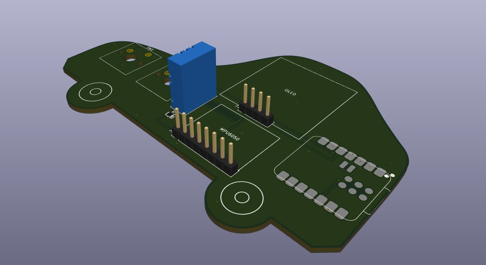

# Starbie Stocks

A talking, steerable toy car on a desk gadget that also watches the stock market. Built for
[Hack Club Half-Life](https://halflife.hackclub.com/) (Week 1 starter project:
Starbie).

Starbie is a XIAO ESP32-C3 board with a 0.96" OLED, an MPU6050 motion sensor, a
DHT11 temperature/humidity sensor and two buttons. A cartoon car talks to you on the screen, and you steer it by rotating the board like a steering wheel.
My twist: a **STOCKS screen**
that shows live prices, the day's change and a sparkline for a watchlist of
tickers, fetched over WiFi.

## Gallery








The board is shaped like a small sports car. The renders show a green solder
mask; the plan for the real board is blue with white silkscreen.

## The four screens

Button 1 cycles through them: CAR → DRIVE → STOCKS → STATS.

- **CAR:** a talking car with a speech bubble. Its eyes follow your steering and a
  steering wheel on the right turns as you rotate the board. Every few seconds it
  comments on the current ticker, the temperature, or which way you're turning.
- **DRIVE:** a tilt-to-steer game. Turn the board to dodge the obstacles on the
  road. It speeds up as your score grows, and your best score is saved.
- **STOCKS:** price, dollar and percent change with an up/down arrow, and a
  sparkline of today's price with a dotted yesterday's-close line.
- **STATS:** temperature, humidity, roll and pitch, and the wheel angle.

WiFi downloads run in a background task, so the screen stays smooth.
## Controls

| Button | Press | What it does |
| --- | --- | --- |
| Button 1 | Short | Next screen |
| Button 1 | Hold ~0.7 s | Re-centre the steering wheel (any screen) |
| Button 2 | Short | CAR: poke the car (it talks). DRIVE: restart after a crash. STOCKS: next ticker. STATS: re-centre the wheel |
| Button 2 | Hold ~0.7 s | STOCKS: previous ticker |

Hold the board upright with the screen facing you and rotate it like a wheel.
Set `STEER_UPRIGHT` to 0 in the firmware if you'd rather lay it flat and tilt it.

## Hardware

| Part | Connection |
| --- | --- |
| XIAO ESP32-C3 | Main board, powered over USB |
| 0.96" SSD1306 OLED (I2C, 0x3C) | SDA = D4 (GPIO6), SCL = D5 (GPIO7) |
| MPU6050 (I2C, 0x68) | SDA = D4, SCL = D5 |
| DHT11 | Data = D1 (GPIO3), 10k pull-up to 3.3 V |
| Button 1 | D2 (GPIO4) to GND, internal pull-up |
| Button 2 | D3 (GPIO5) to GND, internal pull-up |

The passive buzzer in the parts list is not wired on the current PCB and the
firmware does not use it yet.

## Bill of materials

Prices are in US dollars (USD). [BOM.csv](BOM.csv) has the same numbers in
spreadsheet form, and `BOM.md` is the copy that Half Life syncs in automatically.

| Part | What it's for | Qty | Unit | Total | Where to buy |
| --- | --- | --- | --- | --- | --- |
| XIAO ESP32-C3 | Wi-Fi and the main loop (runs the car, game and stock fetching) | 1 | $4.99 | $4.99 | [Seeed Studio](https://www.seeedstudio.com/Seeed-XIAO-ESP32C3-p-5431.html) |
| 0.96" OLED (SSD1306, I2C) | Shows the car, game, stock chart and stats screens | 1 | $9.99 | $9.99 | [Amazon](https://www.amazon.com/dp/B0GBVWBWCR) |
| MPU6050 | Gyro and accelerometer: the steering wheel and the tilt game | 1 | $2.29 | $2.29 | [Amazon](https://www.amazon.com/dp/B0HDTWF4XQ) |
| DHT11 | Temperature and humidity for the STATS screen | 1 | $5.99 | $5.99 | [Amazon](https://www.amazon.com/dp/B07WT2HJ4F) |
| MX switches | Button 1 (next screen) and Button 2 (action in each screen) | 1 | $4.99 | $4.99 | [Amazon](https://www.amazon.com/dp/B0GX1XNZKB) |
| Keycaps | Caps for the two switches | 1 | $8.99 | $8.99 | [Amazon](https://www.amazon.com/dp/B0BWDTBF1L) |
| 10k resistor | Pull-up for the DHT11 data line | 1 | $4.97 | $4.97 | [Amazon](https://www.amazon.com/dp/B0B4JFPHTW) |
| PCB | Custom car-shaped board, made by JLCPCB | 1 | $5.30 | $5.30 | [JLCPCB](https://www.jlcpcb.com/) |
| 2.54 mm breakaway header pins (10 pcs, 40-pin) | Sockets so the OLED and MPU6050 plug in and can be swapped | 1 | $4.59 | $4.59 | [Amazon](https://www.amazon.com/dp/B0GX55WYSX) |
| Passive buzzer | For sound (not used by the firmware yet) | 1 | $5.99 | $5.99 | [Amazon](https://www.amazon.com/dp/B0GKNH6FPR) |
| **Parts subtotal** | | | | **$58.09** | |
| **Tax & shipping** | for the whole order | | | **$7.38** | |
| **Total** | | | | **$65.47** | |

The total is $0.47 over the $65.00 Tier 2 parts funding, which the Half Life
grader says is within its $3 margin. The switches, keycaps, resistors and
headers are sold in multi-piece packs, so the unit price above is the pack
price and there are spares left over.

## Firmware setup

1. In Arduino IDE, open **File > Preferences** and add this to *Additional
   Boards Manager URLs*:
   `https://espressif.github.io/arduino-esp32/package_esp32_index.json`
2. Install **esp32 by Espressif Systems** in Boards Manager, then choose
   **XIAO_ESP32C3** and your port. Set **USB CDC On Boot** to *Enabled* if you
   want to see Serial messages.
3. Install these libraries from Library Manager: Adafruit GFX Library, Adafruit
   SSD1306, Adafruit MPU6050, Adafruit Unified Sensor, DHT sensor library, and
   **ArduinoJson** (version 7).
4. Open `Firmware/Starbie/Starbie.ino` and edit the settings block near the top:

   | Setting | What it does |
   | --- | --- |
   | `WIFI_SSID`, `WIFI_PASS` | Your WiFi name and password (2.4 GHz only) |
   | `TICKERS`, `NUM_TICKERS` | The watchlist: up to 8 symbols of 5 characters or fewer. Keep `NUM_TICKERS` equal to the number of symbols |
   | `STEER_UPRIGHT` | 1 = hold the board upright and rotate it; 0 = lay it flat and tilt |
   | `STEER_SIGN` | Flip between 1 and -1 if the wheel turns the wrong way on screen |
   | `GYRO_SIGN` | Flip between 1 and -1 if the wheel jitters or fights itself |

5. Upload. Keep the board still while the screen says "Keep me still..." so the
   gyro can calibrate.

Never commit your real WiFi password. Leave the placeholders in the repo.

Prices come from Yahoo Finance's public, unofficial chart endpoint with no API
key. It can change or rate-limit at any time, and quotes may be delayed. This is
a toy display, not financial advice.

## Repository layout

```
Firmware/Starbie/Starbie.ino   Arduino sketch (single file)
PCB/                           KiCad project and Gerber export
Renders/                       Schematic, PCB and 3D screenshots
BOM.csv                        Bill of materials (spreadsheet form)
BOM.md                         Bill of materials synced from Half Life
JOURNAL.md                     Build journal
```

## Credits

Based on the Starbie starter project by
[SharKingStudios](https://github.com/SharKingStudios/Starbie) (MIT licensed).
Stock screen, WiFi and data fetching added by me.

## License

MIT. See [LICENSE](LICENSE).
